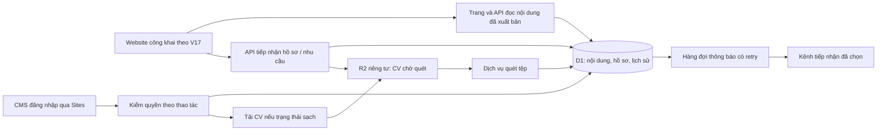

<!-- historical-v19-index -->
> **Tài liệu lịch sử.** Giữ nguyên dữ kiện, kết quả và phạm vi tại thời điểm lập; không phải hướng dẫn hiện hành của V20. Xem [mục lục V20](README.md) và [bàn giao V20](PROTOTYPE-HANDOFF-V20.md).

# Kế hoạch MinhDucWeb: duyệt prototype V17 → vận hành thật

Ngày lập: **01/11/2026**, múi giờ Asia/Bangkok. Trạng thái: **kế hoạch đề xuất, chưa triển khai**.

Định hướng đã được chủ dự án xác nhận: **chia hai chặng; duyệt prototype V17 trước, sau đó triển khai vận hành thật**. V17 là phiên bản hiện tại theo xác nhận của chủ dự án. Mã nguồn và tài liệu cục bộ còn nhiều nhãn V16; cần đối chiếu đúng bản V17 trước khi khóa thiết kế và ước lượng cuối cùng.

## 1. Kết quả cần đạt

**Chặng A — V17 được duyệt:** thống nhất giao diện, nội dung, hành trình người lao động/doanh nghiệp và thao tác CMS; có bản nguồn xác định được, danh sách thay đổi và biên bản duyệt. Biểu mẫu tiếp tục mô phỏng trong chặng này.

**Chặng B — bản vận hành R1.0:** người lao động và doanh nghiệp gửi thông tin thật; hệ thống lưu đúng, người phụ trách xử lý được; nhân viên biên tập và xuất bản nội dung bằng CMS có quyền truy cập. Có kiểm thử, giám sát, sao lưu và hướng dẫn vận hành đủ để bàn giao.

Tên R1.0 là đề xuất cho bản vận hành, nhằm theo dõi riêng mốc duyệt thiết kế V17 và mốc mở dịch vụ thật. Chủ dự án có thể chọn quy ước khác ở A0.

## 2. Hiện trạng đã kiểm tra

| Hạng mục | Bằng chứng trong checkout hiện tại | Hệ quả đối với kế hoạch |
| --- | --- | --- |
| Giao diện công khai | `public/app.js` có trang chủ, giới thiệu, dịch vụ, danh sách/chi tiết việc làm, tuyển dụng nội bộ, tin tức/bài viết và liên hệ | Tái sử dụng thiết kế, kiểm phần thay đổi V17; không cần mặc định thiết kế lại toàn bộ |
| Bốn ngôn ngữ | VI/EN/ZH/KO; CMS tiếng Việt, biên tập nội dung nhiều ngôn ngữ | Chặng A duyệt trải nghiệm bốn ngôn ngữ; chặng B chỉ công bố bản dịch đã được duyệt |
| Form và CMS demo | `public/prototype-v16.js:30` lưu CMS tại localStorage; `:35` mô phỏng gửi form | Đây là phạm vi prototype hiện hành, cần xây kết nối thật trong chặng B |
| Backend được giữ lại | `lib/site-api.ts` có lưu D1, CV R2, receipt, idempotency, rate limit, revision, publish và rollback | Có nền tảng tái sử dụng, nhưng cần nghiệm thu tích hợp lại |
| CMS có bảo vệ nhưng vẫn dùng adapter demo | `scripts/prerender.mjs:22` và `:25` chèn `prototype-v16.js` vào cả template `private-pages/quan-tri.html` | Phải nối lại giao diện quản trị với API, không chỉ mở route đăng nhập |
| Chế độ thử được ghi cố định | `lib/site-validation.ts:69` yêu cầu testOnly; `lib/site-api.ts:59` luôn ghi is_test=1 | Thiết kế cấu hình và hợp đồng dữ liệu demo/staging/production đồng bộ; đổi một biến môi trường chưa đủ |
| Quyền hiện tại | `lib/site-api.ts:13` chỉ chấp nhận owner; danh tính do Sites cung cấp | Chốt số người vận hành và ma trận quyền; thử đăng nhập thật trên hosted |
| CV | `lib/site-api.ts:56` ghi unscanned; `:112` có route tải chưa kiểm trạng thái quét | Chỉ mở luồng CV thật sau khi có quét tệp và chặn tải tệp chưa sạch |
| SEO hiện tại | `public/robots.txt` chặn toàn site; prerender đặt noindex và origin prototype | Phù hợp bản demo; cần một công việc phát hành SEO riêng cho bản thật |
| Nội dung và nguồn build | `scripts/build-static.mjs` sinh CSS/HTML; `scripts/prerender.mjs:12` sinh seed từ app.js | Sửa nguồn rồi tái sinh đầu ra; tránh sửa riêng HTML/seed sẽ bị build ghi đè |
| Tài liệu lệch phiên bản | README và bộ audit mới nhất trong checkout ghi V16; `docs/README.md` còn ghi V14 | A0 xác định nguồn V17 và cập nhật chỉ mục; giữ nguyên báo cáo lịch sử |

**Kiểm chứng mới trong lần lập kế hoạch:** chạy `node --test tests/site-api.test.ts tests/prototype-v16.test.mjs`, **10/10 test qua** trên Node v24.22.1. API tests dùng SQLite và R2 giả lập; hai test prototype kiểm lưu cục bộ và việc form không gửi dữ liệu. `package.json` hiện chỉ đưa API tests vào lệnh test mặc định.

Chưa chạy lại build, trình duyệt, SSO hosted hoặc kiểm dữ liệu production trong lần lập kế hoạch này. Kết quả audit 91,4/100 và các ma trận giao diện trong tài liệu là bằng chứng lịch sử V16, **chưa phải kết quả V17 hoặc nghiệm thu vận hành thật**. Checkout có thay đổi sẵn và thư mục artifacts; cần đối chiếu chúng ở A0.

## 3. Chặng A — duyệt prototype V17

Ước lượng **4–6 ngày làm việc**, chưa tính thời gian chờ phản hồi. Đầu ra của chặng này là một bản thiết kế và phạm vi có thể triển khai ổn định.

| Mốc | Công việc | Đầu ra / điều kiện hoàn thành | Người chính | Ước lượng |
| --- | --- | --- | --- | --- |
| A0 — xác lập V17 | Đối chiếu checkout, thay đổi chưa commit, gói bàn giao và bản trình diễn; xác định phần nào là V17. Khóa nguồn bằng commit hoặc manifest hash kèm bản đóng gói/URL; ghi thay đổi từ V16. Build và kiểm mở các trang chính trên đúng bản đem duyệt; đồng bộ README/chỉ mục tài liệu hiện hành | Baseline V17 có nguồn và đầu ra khớp nhau; không đổi nhãn audit cũ thành V17; bản cần duyệt trỏ đúng nguồn | Dev + chủ dự án | 1 ngày |
| A1 — rà và hoàn thiện | Đi qua ba nhóm tác vụ; kiểm nội dung, CTA, biểu mẫu, responsive, CMS và bản dịch. Sửa các lỗi chặn thao tác/hiểu sai, tổng hợp các thay đổi thiết kế trong một lượt | Ma trận trang × tác vụ × thiết bị/ngôn ngữ; danh sách vấn đề kèm ảnh và trạng thái | Dev/UI + QA | 2–3 ngày |
| A2 — trình duyệt và khóa phạm vi | Demo theo kịch bản bên dưới, ghi phản hồi theo màn hình; xử lý một vòng chỉnh sửa đã thống nhất; ghi phần được duyệt và phần chuyển backlog | Biên bản duyệt V17, sitemap, danh sách component/state, phạm vi R1.0 và backlog | Chủ dự án + dev | 1–2 ngày |

### Kịch bản duyệt V17

1. **Người lao động:** vào từ điện thoại → tìm/lọc việc → xem lương, địa điểm, ca, quyền lợi → so sánh/lưu việc → ứng tuyển demo → hiểu rõ kết quả mô phỏng. Kiểm cả trường hợp không có kết quả, tin đóng, thiếu dữ liệu và nhập sai.
2. **Ứng viên nội bộ:** đọc điều kiện → chọn CV mẫu → sửa lỗi định dạng/dung lượng → hoàn tất demo. Không tải CV thật lên hệ thống trong chặng A.
3. **Doanh nghiệp:** xem dịch vụ và thông tin năng lực → chọn nhu cầu → sang liên hệ có giữ ngữ cảnh → gửi demo → biết bước tiếp theo. Nội dung ước tính phải nói đúng mức cam kết mà Minh Đức duyệt.
4. **Biên tập viên:** sửa Home, ảnh, tin tuyển dụng, bài viết và bản dịch → lưu demo → xem trước → thử nội dung dài/thiếu ảnh → xuất bản sao JSON. Bố cục phải ổn định khi nhập liệu thực tế.

### Điều kiện qua mốc A

- Chủ dự án duyệt bản V17 cụ thể, ưu tiên mobile, hai luồng công khai và CMS.
- Không còn lỗi chặn hoàn tất tác vụ, mất nội dung đang nhập hoặc nội dung khiến người xem hiểu nhầm form đã gửi thật.
- Kiểm màn hình 320/390/768/1440px; bốn ngôn ngữ; bàn phím, focus, lỗi form và chữ phóng 200% trên mẫu đại diện. Ghi rõ môi trường kiểm, không suy phép thử iframe thành thiết bị thật.
- Có danh mục nội dung cần Minh Đức cung cấp: thông tin doanh nghiệp, hotline, địa chỉ, dịch vụ, tin tuyển dụng, ảnh/video, logo/case được phép dùng, bản dịch và người duyệt.
- Ghi rõ nội dung mẫu, ảnh minh họa và bản dịch fallback được phép giữ trong V17 để duyệt thiết kế; mỗi mục cần thay có người phụ trách và hạn trước B3. Duyệt prototype không đồng nghĩa phê duyệt dữ kiện để công bố production.
- Mỗi tính năng được ghi rõ: đã duyệt giao diện, cần thay đổi, hoặc hoãn sau R1.0.

**Điểm chuyển chặng:** chỉ bắt đầu triển khai R1.0 theo thiết kế đã duyệt. Việc khóa phạm vi này là mốc sản phẩm theo lựa chọn hai chặng của chủ dự án.

## 4. Phạm vi R1.0 đề xuất

| Nhóm | Có trong bản vận hành đầu tiên | Để sau R1.0 |
| --- | --- | --- |
| Người tìm việc | Tìm/lọc/sắp xếp, thông tin việc làm thật, trạng thái còn tuyển, ứng tuyển không cần tài khoản, mã tiếp nhận, thử lại khi lỗi | Tài khoản ứng viên, theo dõi toàn bộ vòng đời tuyển dụng, đề xuất việc bằng AI |
| Tuyển dụng nội bộ | Form có CV nếu hoàn tất pipeline quét và quyền tải | ATS đầy đủ, chấm CV tự động, lịch phỏng vấn tích hợp |
| Doanh nghiệp | Nội dung dịch vụ thật, yêu cầu tư vấn, xác nhận đã nhận và người phụ trách xử lý | Cổng khách hàng, báo giá/hợp đồng/thanh toán tự động |
| CMS | Home, việc làm, bài viết, đối tác, ảnh, bản dịch, nháp/xem trước/xuất bản/khôi phục; quyền theo nhiệm vụ | Trình dựng trang tự do, workflow phê duyệt nhiều tầng |
| Xử lý hồ sơ/yêu cầu | Hộp thư, lọc/phân trang, người phụ trách, trạng thái, ghi chú tối thiểu và nhật ký | CRM phức tạp, đồng bộ nhiều hệ thống cùng lúc |
| Ngôn ngữ | Giữ cấu trúc VI/EN/ZH/KO; chỉ mở nội dung đã hiệu đính. VI là nội dung gốc | Tự dịch/tự xuất bản bằng AI |
| Vận hành | Một kênh thông báo được chọn, lỗi/retry theo dõi được, sao lưu/khôi phục, chính sách lưu/xóa | Báo cáo BI, marketing automation, nhiều kênh gửi song song |

Đề xuất quyền tối thiểu nếu có nhiều nhân viên: **owner** quản trị quyền và xuất bản; **editor** sửa nội dung/xem nháp; **recruiter** xử lý hồ sơ và tải CV sạch. Editor không mặc định có quyền đọc hồ sơ. Nếu Minh Đức chỉ dùng một owner lúc đầu, khóa phạm vi đơn giản đó ở A2 và điều chỉnh ước lượng.

## 5. Kiến trúc triển khai

**Giữ nền tảng Sites + Vinext/Workers + D1/R2 hiện có** trong giai đoạn đầu, với điều kiện kiểm khả năng vận hành ở B0. Tách dần mã theo tính năng khi nối API và sửa lỗi; dùng thiết kế V17 làm chuẩn hình ảnh. Việc chuyển framework hoặc hosting chỉ đặt ra khi thử nghiệm B0 chỉ ra giới hạn cụ thể.

Các quyết định kỹ thuật:

- **Ba chế độ rõ ràng:** prototype dùng dữ liệu mẫu; staging dùng dữ liệu giả nhưng API thật; production dùng dữ liệu đã duyệt. Chế độ được quyết định tại server/build, không cho client tự chuyển để bỏ validation. Thiếu/sai mode hoặc binding phải từ chối ghi, không tự chuyển sang dữ liệu thật. B0 kiểm cơ chế tách tài nguyên của hosting; giữ danh tính và audience của Site hiện có khi cập nhật.
- **Adapter dữ liệu riêng:** giữ trải nghiệm demo độc lập; tạo adapter vận hành từ backend/runtime hiện hữu. Template CMS thật phải nạp đúng adapter và trạng thái save/publish thực tế.
- **Nội dung:** giữ snapshot/revision hiện có cho quy mô ban đầu; ảnh lưu thành tệp, không nhúng base64 lớn vào JSON. Quyết định chuẩn hóa jobs/posts/translations khi số lượng nội dung hoặc nhu cầu sửa đồng thời cho thấy cần thiết.
- **SEO:** trang chi tiết cần HTML ban đầu, metadata và canonical đúng tin/bài/ngôn ngữ từ dữ liệu đã xuất bản. Có thể giữ URL cũ nếu đáp ứng yêu cầu; nếu đổi sang slug phải có bảng redirect. Không chỉ sửa title bằng JavaScript sau khi trang tải.
- **Đăng nhập:** tái sử dụng danh tính Sites và kiểm membership phía server; kiểm trực tiếp hosted để xác nhận không tin header do khách tự gửi. Nhu cầu đăng nhập riêng ngoài ChatGPT phải được đánh giá ở B0 trước khi chọn giải pháp khác.
- **Dữ liệu nghiệp vụ:** bổ sung trạng thái xử lý, người phụ trách, dấu thời gian, phiên bản consent, trạng thái quét CV và thời điểm xóa theo chính sách được duyệt. Migration bổ sung, giữ nguyên lịch sử đã áp dụng.
- **Thông báo:** lưu hồ sơ và sự kiện cần gửi cùng giao dịch D1; tác vụ nền gửi thông báo, retry có giới hạn, ghi lỗi và cho gửi lại có kiểm soát. Hộp thư trong CMS là nơi đối soát khi kênh ngoài gặp lỗi. B0 xác minh runner và dịch vụ được hỗ trợ trước khi chốt tích hợp.
- **Quyền riêng tư:** tên/số điện thoại/CV không đưa vào URL, analytics hoặc log lỗi. Danh sách người nhận, thời hạn lưu và quy trình xóa phải do Minh Đức xác nhận trước khi mở form thật.

## 6. Chặng B — triển khai vận hành thật

Ước lượng **23–33 ngày công kỹ thuật**, cộng dự phòng khoảng 15–20%; tương đương khoảng **6–8 tuần** với một dev toàn thời gian, QA bán thời gian và chủ nội dung phản hồi đều. Đây là ước lượng sơ bộ, chưa phải cam kết ngày phát hành.

Ước lượng B2 giả định B0 đã xác nhận dịch vụ quét, kênh thông báo và runner sẵn có. Nếu phải xây hạ tầng nền mới hoặc đổi hosting, cần ước lượng lại trước B1/B2. B0 cũng chốt lượng hồ sơ/ngày, tải đồng thời, dung lượng tệp và số người vận hành; dùng các giả định đó để đặt ngưỡng tải, độ trễ và lỗi cho B4.

| Mốc | Công việc và đầu ra | Nghiệm thu bắt buộc | Phụ thuộc | Ngày công |
| --- | --- | --- | --- | ---: |
| B0 — nền tảng | Build tái lập; một lệnh chạy đủ tests; TypeScript/JS checks; thiết lập staging tách dữ liệu; xác minh Sites auth, secrets, runner, dịch vụ scan/thông báo, phương án backup. Ghi quyết định kiến trúc | Người khác chạy được theo hướng dẫn; test/build có kết quả; staging không ghi vào dữ liệu thật; các phụ thuộc quan trọng khả thi | A2 | 3–4 |
| B1 — CMS vận hành | Nối adapter thật; quyền; lưu nháp, preview, publish, history/restore; media upload; bản dịch và revision conflict. Kiểm dữ liệu biên của V17 | Lưu thấy trên máy khác; nháp không lộ; xuất bản đổi đúng nội dung; hai người sửa không ghi đè âm thầm; restore có thể đối chiếu | B0 | 4–6 |
| B2 — form và hộp thư | Intake production cho lao động/doanh nghiệp/nội bộ; consent; receipt; retry/idempotency; phân trang, lọc, trạng thái, phân công. Quét CV, gate tải, retention/xóa. Một kênh thông báo | Gửi → lưu một bản ghi → thấy trong CMS → người phụ trách xử lý được; mất mạng sau commit không tạo trùng; CV chưa sạch không tải được; xóa đồng bộ D1/R2 | B0; hợp đồng nội dung B1 | 6–8 |
| B3 — nội dung và khả năng tìm thấy | Nội dung/ảnh thật, bản dịch, trang chính sách; HTML/metadata đúng mỗi tin/bài; canonical/hreflang/sitemap; đóng tin hết hạn; tối ưu assets và analytics tối thiểu | Không còn placeholder trên các trang mở vận hành; URL và metadata đúng; dữ liệu nháp/thử không vào sitemap; sự kiện không chứa PII | B1; nội dung được duyệt | 4–6 |
| B4 — nghiệm thu và mở vận hành | E2E trên hosted, thiết bị thật, bàn phím/screen reader, lỗi mạng/lưu trữ, tải đồng thời phù hợp quy mô; đo performance; diễn tập restore/rollback; bàn giao người vận hành | Qua các điều kiện mục 8; chạy thử với nhóm nhỏ; kiểm lại sau phát hành; có đầu mối xử lý sự cố | B1–B3 | 6–9 |

Nội dung có thể chuẩn bị từ chặng A và chạy song song với B0–B2. Khi có thêm nhân lực, B3 và một phần UI của B2 có thể chạy song song sau khi thống nhất API; không giảm thời gian kiểm quyền, CV và phục hồi dữ liệu bằng cách bỏ kiểm thử.

**Đường phụ thuộc chính:** A0 → A1 → A2 → B0 → B1/B2 → B3 → B4. Phê duyệt nội dung và chọn dịch vụ tích hợp có thể trở thành phần chậm nhất.

## 7. Backlog theo mức ưu tiên

P0: điều kiện bắt buộc để mở đúng phạm vi vận hành; P1: phải hoàn tất trước phát hành rộng; P2: tối ưu sau R1.0.

| ID | Mức | Việc | Nơi bắt đầu / tiêu chí |
| --- | --- | --- | --- |
| MD-A01 | P0 chặng A | Xác lập baseline V17, lập changelog và chỉ mục tài liệu | README, docs, nguồn hiện có và bản trình diễn cần đối chiếu |
| MD-A02 | P0 chặng A | Rà ba nhóm hành trình, sửa lỗi, ghi duyệt | Prototype, bản dịch, form, CMS; giữ evidence V17 riêng |
| MD-B01 | P0 | Tách demo/staging/production và adapter | `scripts/prerender.mjs`, `public/prototype-v16.js`, `public/v15-runtime.js`, `lib/site-api.ts` |
| MD-B02 | P0 | Kiểm đăng nhập/ủy quyền trên hosted | `app/quan-tri.html/route.ts`, `lib/site-api.ts`, `db/schema.ts`; đủ anonymous/nonmember/các role |
| MD-B03 | P0 | CMS lưu/xuất bản/khôi phục thật | Hai phiên sửa, 409, lưu thất bại, preview revision, public cache sau publish |
| MD-B04 | P0 | Intake production và chống gửi trùng | `lib/site-validation.ts`, `lib/site-api.ts`; bỏ hardcode test theo hợp đồng môi trường mới |
| MD-B05 | P0 nếu nhận CV | Scan CV, trạng thái và gate tải | Quét fail/timeout/rejected/clean; URL trực tiếp và người sai quyền đều bị chặn |
| MD-B06 | P0 | Hộp thư, người xử lý, retention và xóa | Phân trang hơn 100 hồ sơ; cập nhật có kiểm quyền; xóa record/file và đối soát |
| MD-B07 | P0 | Nội dung liên hệ, việc làm, dịch vụ và chính sách thật | Mỗi thông tin quan trọng có người duyệt; bản dịch khớp nội dung nguồn |
| MD-B08 | P0 | Kiểm thử và phục hồi | Tests hiện có + tích hợp hosted + restore dữ liệu; runbook có người chịu trách nhiệm |
| MD-B09 | P1 | Thông báo tin cậy | Dịch vụ được chọn; lỗi gửi không mất hồ sơ; retry và nhận trùng được xử lý |
| MD-B10 | P1 | SEO từng URL, ngôn ngữ, vòng đời tin | Prerender/server render, metadata, sitemap, robots; kiểm hết hạn và URL không tồn tại |
| MD-B11 | P1 | Thiết bị thật, tiếp cận và hiệu năng | Android/iOS, bàn phím ảo, keyboard/screen reader; số đo có môi trường rõ |
| MD-B12 | P1 | Media và đơn giản hóa nguồn | Upload ảnh; tách module khi sửa luồng; dọn CSS có đối chiếu ảnh trước/sau |
| MD-C01 | P2 | AI hỗ trợ, CRM mở rộng, báo cáo nâng cao | Chỉ chọn sau khi có nhu cầu vận hành và số liệu sử dụng |

Nếu scan CV chưa sẵn sàng, có thể đề xuất một bản ra mắt giới hạn chỉ nhận nhu cầu doanh nghiệp và ứng tuyển phổ thông không tệp. Đây là thay đổi phạm vi phải được chủ dự án quyết định; luồng CV vẫn là hạng mục chưa hoàn thành.

## 8. Tiêu chí nghiệm thu R1.0

### Hành trình và dữ liệu

- Mỗi loại form trong phạm vi phát hành có E2E thật: giao diện → API → D1/R2 nếu có → receipt → CMS → thao tác của người phụ trách.
- Thành công chỉ hiển thị sau khi xác nhận lưu; lỗi giữ dữ liệu và cho thử lại. Gửi lặp cùng lượt không nhân đôi; payload khác dùng lại mã bị từ chối.
- Tin đóng/hết hạn không tiếp tục nhận hồ sơ theo hợp đồng đã thống nhất. Nhu cầu doanh nghiệp giữ được dịch vụ và thông tin đã chọn.
- CMS có luồng quyền, nháp, xem trước, xuất bản và khôi phục được thử trên hosted, không chỉ qua API giả lập.

### Bảo vệ dữ liệu và vận hành

- Người không có quyền không đọc được hồ sơ, draft hoặc CV; quyền được kiểm ở mọi endpoint tương ứng.
- CV chỉ tải khi sạch; kiểm kết quả scan bất thường, tệp quá cỡ, tệp giả định dạng, lưu dở và dọn tệp mồ côi.
- Chính sách consent/lưu/xóa có người duyệt; việc xóa bao gồm D1 và tệp R2, đồng thời xử lý phù hợp khi khôi phục backup.
- Có nhật ký đủ truy lỗi nhưng không chứa nội dung hồ sơ; thông báo lỗi vận hành và người tiếp nhận được xác định.
- Diễn tập rollback ứng dụng, rollback nội dung và restore dữ liệu riêng. Chốt mục tiêu thời gian khôi phục/mức mất dữ liệu chấp nhận được ở B0, rồi đo thực tế ở B4.

Cloudflare D1 có cơ chế Time Travel; cần xác minh quyền truy cập và cách thực hiện qua nền tảng Sites trước khi đưa vào runbook. Việc phục hồi D1 phải đi cùng đối soát R2 và thông báo đã gửi. [Tài liệu D1 Time Travel](https://developers.cloudflare.com/d1/reference/time-travel/).

### Giao diện, nội dung và SEO

- Không còn lỗi chặn hành trình trên Android Chrome, iOS Safari và desktop đại diện; kiểm bàn phím ảo, focus, lỗi form, chữ phóng và giảm chuyển động.
- Chủ nội dung duyệt tiếng Việt, liên hệ, tin việc làm và các bản dịch được công bố. Có nguồn/quyền cho hình ảnh và tuyên bố năng lực.
- `JobPosting` chỉ áp dụng đúng trang chi tiết việc làm; nội dung schema khớp phần người dùng đọc; xử lý tin hết hạn. Kiểm crawl, sitemap và metadata trước khi mở index. [Hướng dẫn JobPosting của Google](https://developers.google.com/search/docs/appearance/structured-data/job-posting).
- Mục tiêu sàng lọc lab đề xuất: LCP ≤2,5 giây, CLS ≤0,1 trên cấu hình mobile/mạng được ghi rõ; ít nhất ba lượt cho các template trọng yếu. Đo tương tác đại diện, theo dõi field khi đủ dữ liệu. Đây là mục tiêu kiểm, chưa phải số đo hiện tại hoặc cam kết CWV.
- Mọi hạn chế còn lại có chủ sở hữu và quyết định phát hành rõ ràng. Điểm audit prototype không thay cho các điều kiện trên.

## 9. Dữ liệu cần chốt và người chịu trách nhiệm

| Quyết định | Đề xuất để lập kế hoạch | Chốt trước |
| --- | --- | --- |
| Nguồn/bản trình diễn V17 | Đối chiếu checkout này với bản mà chủ dự án gọi là V17 | Kết thúc A0 |
| Người duyệt thiết kế và nghiệp vụ | Một đầu mối Minh Đức tổng hợp phản hồi | A1 |
| Số người dùng CMS và cách đăng nhập | Dùng Sites hiện có; ba role nếu có nhiều người vận hành | A2/B0 |
| Ngôn ngữ mở vận hành | VI bắt buộc; EN/ZH/KO theo nhu cầu FDI và tiến độ hiệu đính | A2 |
| Chủ xử lý hồ sơ/nhu cầu và giờ phản hồi | Một người chính, một người dự phòng; cam kết thời gian phản hồi do Minh Đức chọn | B2 |
| Kênh thông báo hoặc CRM/Sheets | Chọn một nơi nhận chính; inbox CMS giữ dữ liệu chuẩn | B0 |
| Thời hạn lưu, quyền đọc/xóa, nội dung consent | Do người phụ trách dữ liệu Minh Đức xác nhận; dev hiện thực theo quyết định đó | B2 |
| Hosting, tên miền và ngân sách dịch vụ | Tái sử dụng Sites; kiểm hỗ trợ domain, runner, scan, backup và chi phí khi chốt phạm vi | B0 |
| Bộ nội dung thật | Pháp nhân, địa chỉ/hotline, dịch vụ, tin thật, ảnh/case, bản dịch và người phê duyệt | B3 |

Chưa định giá tiền trong kế hoạch này vì chưa chốt nhà cung cấp, mức tải, dịch vụ quét và kênh tích hợp. Khoản cần dự toán riêng gồm hosting/lưu trữ, domain nếu cần, quét tệp, thông báo, nội dung/ảnh và hiệu đính.

## 10. Đo kết quả và bàn giao

Sau khi mở vận hành, theo dõi: số lượt xem tin → bắt đầu form → gửi được lưu thành công; nhu cầu doanh nghiệp hợp lệ; hồ sơ chưa được phân công; thời gian tiếp nhận → liên hệ đầu tiên; lỗi gửi/lưu/thông báo. Gắn mã sự kiện và mã hồ sơ nội bộ phù hợp, không đẩy tên/số điện thoại/CV vào analytics. Chốt mục tiêu tăng chuyển đổi sau khi có baseline sử dụng thật.

**Bàn giao chặng A:** baseline V17, changelog, ma trận kiểm, biên bản duyệt, bản đồ trang và phạm vi R1.0.

**Bàn giao chặng B:** source/release xác định được, migrations, ma trận quyền, bằng chứng kiểm thử hosted, hướng dẫn CMS và xử lý hồ sơ, hướng dẫn sao lưu/khôi phục, danh sách cấu hình không chứa secret, đầu mối vận hành và backlog sau launch.

**Bước bắt đầu khi triển khai kế hoạch:** thực hiện A0 — đối chiếu và khóa đúng prototype V17, sau đó duyệt theo bốn kịch bản ở chặng A.
